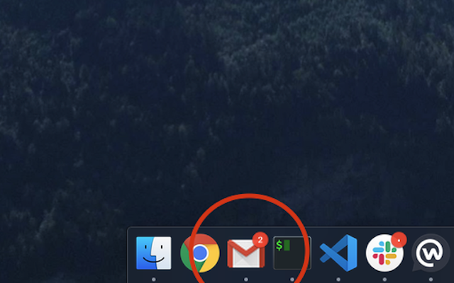
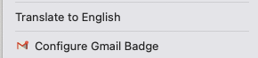
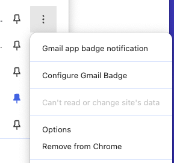
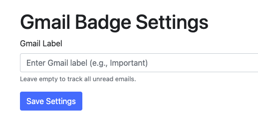
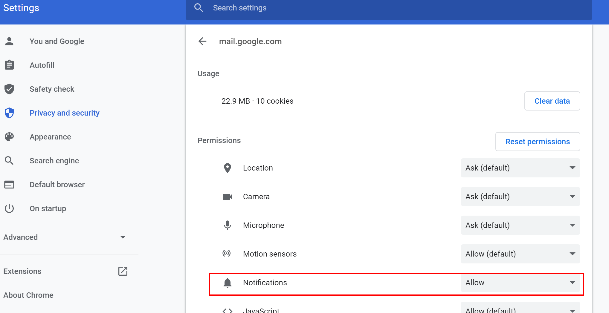

# Gmail app badge notification

You can download this extension [here](https://chrome.google.com/webstore/detail/gmail-app-badge-notificat/fbaolhbfbmniffcokakochjjeccpcpkh).

## Setup

1. Install the extension.
2. Open [Gmail](https://mail.google.com) in a Chrome tab, or reload it if it is already open.
3. Install Gmail as an app from the Chrome menu: **Cast, save, and share → Install page as app…**
4. Open the newly installed app.

The extension must be installed before you install the app: it makes Chrome install Gmail as a regular app, the only kind whose icon Chrome badges.

## Usage

By default it will track all emails on the inbox. You can filter based on custom labels if you on;y want to keep track of specific labels

### Tracking emails pon specific labels

When you right click, you get the option to add the label

or you can click on the extension and click "configure"

When you click it, a new tab opens on the browser to add the label. Then you can type the label you want to see notifications for and then you can close that tab.

If you want to go back to track everything again, just remove the label and click save.

## Troubleshooting

The extension hasn't been heavily tested. If you are experiencing any problems, please [open an issue](https://github.com/aberonni/gmail-app-badge-notification/issues/new).

#### Previous apps

If you already had a Gmail app, remove it from the [chrome://apps](chrome://apps) page and install it again by following [Setup](#Setup). Gmail apps installed without the extension, or before version 1.3.0, never show a badge.

#### macOS Dock

If the app still shows no badge on macOS, enable `chrome://flags/#enable-mac-pwas-notification-attribution` and relaunch Chrome. It registers each Chrome app with macOS notifications, and recent macOS versions show Dock badges only for registered apps.

#### Notifications

You might have to manually enable notifications for the app. You can do so from the [chrome://apps](chrome://apps) page. Right click on the app you previously created and select "App info". Under "Privacy and security" settings, make sure to allow notifications.

